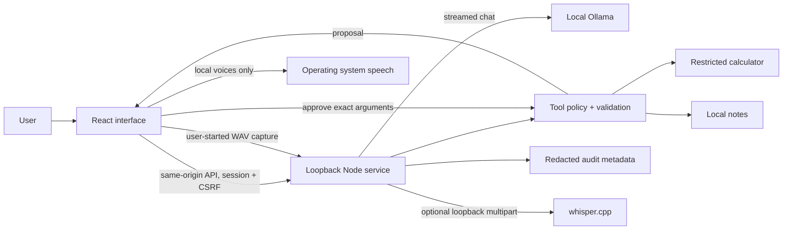

# Architecture

Auralis separates the expressive interface from the local inference and capability boundary. The browser is an interface, the Node service is the policy enforcement point, and the model is an untrusted proposer.

## Interface

React owns the current conversation, streaming status, selected model, memory inspection, approvals, and voice state. The initial screen works when inference is unavailable and reports the missing dependency clearly. There is no fabricated online indicator or fallback answer.

CSS drives the ambient orb and interface transitions. Avoiding a large 3D scene reduces rendering work and asset downloads. Reduced motion must disable nonessential movement. The interface uses locally available fonts and bundled assets rather than requesting remote presentation resources.

History is in memory by default. An explicit export transfers responsibility for that file to the user. Clearing the session and deleting persistent notes are distinct actions because they affect different data.

## Request boundary

The API listens on `127.0.0.1:4317`. In development, Vite forwards requests from its own local origin. In a built application the same server serves the interface and API.

Host and origin validation limit browser-origin and DNS rebinding attacks. The session endpoint establishes an unpredictable session cookie and returns a CSRF value. Mutating requests include that value in `x-auralis-csrf`; the cookie is HttpOnly and SameSite Strict. Server-side schemas reject unexpected tool names and malformed arguments. Request and response bounds reduce accidental resource exhaustion.

These controls do not make a hostile same-user native process safe. They also do not secure another service merely because that service is running on the same Mac.

## Generation lifecycle

1. Validate the request and session, model, profile, and message list.
2. Admit one active generation. Reject overlapping work rather than silently multiplying model memory use.
3. Send bounded conversation context to the configured local Ollama endpoint.
4. Forward parsed output as newline-delimited JSON events.
5. Validate tool calls independently of the model. Compute safe pure operations, or issue a proposal for a side effect.
6. Report observed request timing and provider metrics when available.
7. End or cancel the upstream request when the browser disconnects or the operation is aborted.

Fast requests use a 2,048-token context; Balanced uses 4,096. Both have a bounded output budget. A short keep-alive permits model unloading after inactivity. This is a memory-conscious starting point, not an assurance that every installed model fits a 16 GB machine.

The stream is application-level NDJSON, not raw Ollama data. Keeping a small contract allows another local runtime adapter to be added without rewriting UI parsing.

## Tools

The initial capability surface is deliberately small:

- A restricted calculator evaluates supported arithmetic without executing JavaScript or shell code.
- `note.save` asks the user to review the title and content. The server holds a short-lived proposal, validates approval, writes once, and invalidates the proposal.

Saved notes are not an arbitrary filesystem interface. A tool cannot choose a path, execute a command, install a dependency, fetch a URL, or enroll another tool. Approval is for one concrete invocation rather than a general grant.

Tool schemas are protocol descriptions, not authorization. All validation, expiry, and approval rules live on the server. Text that says “approved” has no authority. A failed or rejected call returns a visible result.

## Memory

The application data directory contains approved notes and a redacted event log. Owner-only permissions reduce unintended access by other local accounts. Note writes replace a temporary file atomically. The diagnostic audit log is bounded and can reset once its size limit is exceeded; it is not an immutable ledger. Notes remain plaintext at rest; use macOS account protection and disk encryption as appropriate. The store is not a secret vault.

There is no hidden embedding index, background document ingestion, or automatic learning from conversation history. Adding retrieval later requires explicit source selection, deletion semantics, and a way to show which data entered a model request.

## Voice

Voice capture starts only after a direct user action. The browser creates a WAV payload and releases microphone resources when recording ends. The Node service forwards audio only to the configured loopback transcription endpoint. It does not use browser `SpeechRecognition`, which may involve a remote service.

Speech output filters browser voices by `localService`. That property is the browser's declaration; it is not a packet-level proof of the operating system's behavior. If a local voice is missing, text output remains available. See [voice setup and limits](voice.md).

## Extension plan

Keep provider adapters, tool definitions, policy enforcement, and persistence independent. MLX and llama.cpp are research-backed runtime alternatives, but an alternative runtime is not integrated merely because it is documented. A future native macOS shell can improve microphone, notification, and process lifecycle integration without relaxing tool policy.

Before adding MCP, shell access, autonomous background tasks, or remote connectors, specify authentication, filesystem / network scope, approval semantics, cancellation, quotas, and audit redaction. Those are roadmap items, not shipped capabilities.
